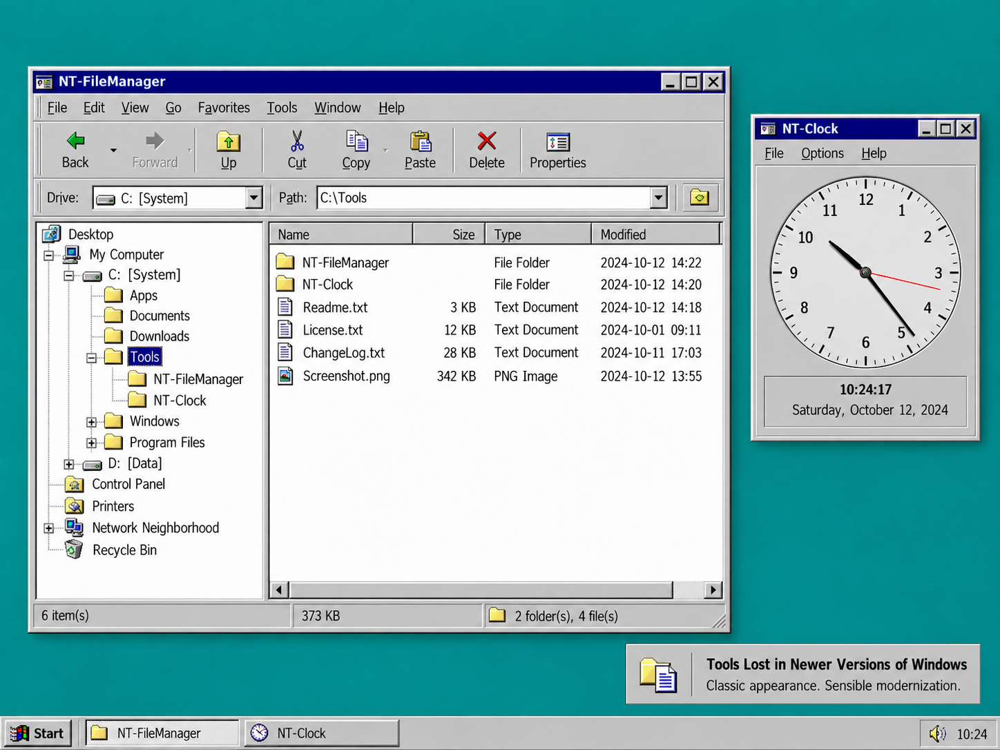

# Tools lost in newer versions of Windows

Small, independent Windows utilities inspired by familiar tools from the classic Windows era.

**English** | [Deutsch](README.de.md)

*Generated illustration of the project’s visual direction; actual applications may differ.*

## Why this project exists

Some older Windows tools are fondly remembered for their appearance, simplicity, and way of working. This repository explores bringing that feeling back through small, independent utilities.

This is a **just-for-fun, nice-to-have hobby project**: a place to experiment, enjoy a little nostalgia, and build something useful when time and interest allow. There are no deadlines, promised release dates, or commitments to implement every idea.

## Project philosophy

- **Recognizable classic Windows appearance.** Preserve familiar visual cues and straightforward workflows where they help people feel at home.
- **Sensible modernization.** Improve usability, reliability, and compatibility where it makes practical sense.
- **No obsessive pixel-perfect replication.** The original look is inspiration, not a constraint that justifies awkward code or unnecessary effort.
- **Small, independent utilities.** Each application has its own purpose and can evolve at its own pace. Keep implementation and documentation proportionate to a hobby project.

## Existing applications

| Application | Description |
| --- | --- |
| [NT-Clock](NT-Clock/README.md) | A Windows Forms clock inspired by Windows NT 4.0, with analog and digital displays, an alarm, and tray support. |
| [NT-FileManager](NT-FileManager/README.md) | A retro-inspired Windows Forms file manager with classic directory windows, a tree view, and everyday file operations. |

These directories contain implementations. See their individual READMEs for details and build instructions. Application documentation currently uses a mixture of English and German; English is the default for this repository overview, with a linked German translation.

## Ideas to explore

The following directories contain **minimal project scaffolds, with no utility features implemented**. Each solution opens a concept placeholder window. They record possibilities, not a roadmap or delivery promise.

| Idea | Possible direction |
| --- | --- |
| [NT-Write](NT-Write/README.md) | A small writing utility inspired by classic Windows Write. |
| [NT-Cardfile](NT-Cardfile/README.md) | A simple card-based organizer inspired by Windows Cardfile. |
| [NT-ProgramManager](NT-ProgramManager/README.md) | A program launcher using familiar program groups. |
| [NT-Clipboard](NT-Clipboard/README.md) | A compact viewer for the current clipboard contents. |

## Build and explore

Start with an existing application's README and solution file. The current applications use C# and Windows Forms; their documented development environment is Visual Studio 2022 on Windows. Each application is built separately.

## License

This repository is licensed under [Apache License 2.0](LICENSE). These are independent projects inspired by classic Windows utilities.
